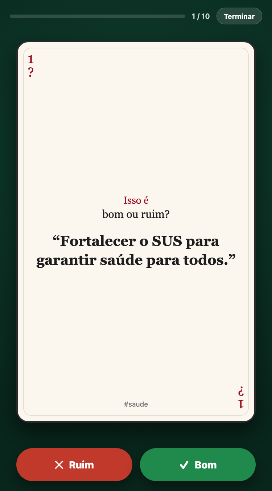
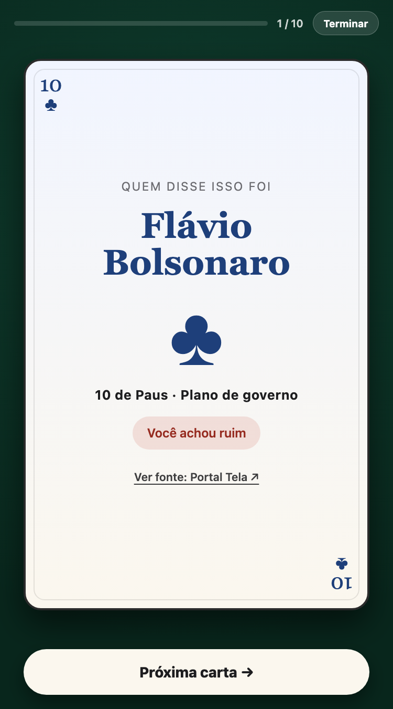

# 🃏 Baralho — Isso é bom ou ruim?

> A mobile-first card game about Brazilian politics: you judge a proposal **without knowing who said it**, then the card flips and reveals the author.

**▶ Play it:** <https://joaodavil4.github.io/baralho-politico/>

<p align="center">
  
  
  
</p>

---

## Project at a glance

| | |
|---|---|
| **Date** | October 10, 2026 |
| **Author** | João Davila ([@joaodavil4](https://github.com/joaodavil4)) |
| **Stack** | Plain HTML, CSS and JavaScript. No framework, no build step, no backend |
| **Hosting** | GitHub Pages |
| **Language** | Portuguese (pt-BR) |

## The idea

Political debate is often about *who* said something rather than *what* was said. This game flips that:

1. A card shows a proposal or statement and asks **"Isso é bom ou ruim?"** (*Is this good or bad?*)
2. You answer **Bom** or **Ruim** before knowing the author.
3. The card flips and reveals who said it (and links to the source).
4. After 10 cards you see which candidate's proposals you agreed with more.

It is meant as a game to make you think, not a voting guide, and the result screen says so.

## How it plays

- **10 cards per game**, drawn at random: 5 from each candidate, then shuffled together, so every game is balanced regardless of the size of each pool.
- **Playing-card theme**: every card has a rank and suit (♥ ♠ for one candidate, ♦ ♣ for the other), a flip animation, and a felt-table background.
- **"Terminar" button** to finish early and see the result with the cards answered so far.
- **Review list** on the result screen, showing each statement, your answer and who said it.
- **Installable**: ships a web manifest and icons, so it can be added to a phone's home screen.

## Content

The deck lives in [`data.js`](data.js): 50 cards, each with a statement, a topic tag (economy, security, education, health, …), the candidate, and a link to where it came from. 18 of the cards are extras, tagged either as a *plano de governo* (government plan) or a *declaração* (statement), with the name of the outlet that reported them.

The cards are short paraphrases of public proposals and statements, collected for this project. They are **not** an endorsement of any candidate, party or position, and the author makes no claim that the selection is exhaustive or perfectly representative. Every card links to its source so you can check it yourself.

## Running locally

No install needed. It's a static site:

```bash
git clone https://github.com/joaodavil4/baralho-politico.git
cd baralho-politico
python3 -m http.server 8000   # then open http://localhost:8000
```

## Project structure

```
index.html            Start, game and result screens + the "finish" modal
style.css             Card, flip, felt table and responsive layout
app.js                Game logic: shuffling, answering, scoring, confetti
data.js               The 50 cards and the candidates' colours
manifest.webmanifest  PWA manifest (home-screen install)
icon*.png / icon.svg  App icons
screenshots/          Images used in this README
```

## Possible next steps

- More cards and more candidates or parties, with a balance check between pools.
- Show each card's source link in the review list, not only on the flipped card.
- English version of the interface.
- Offline support with a service worker.
